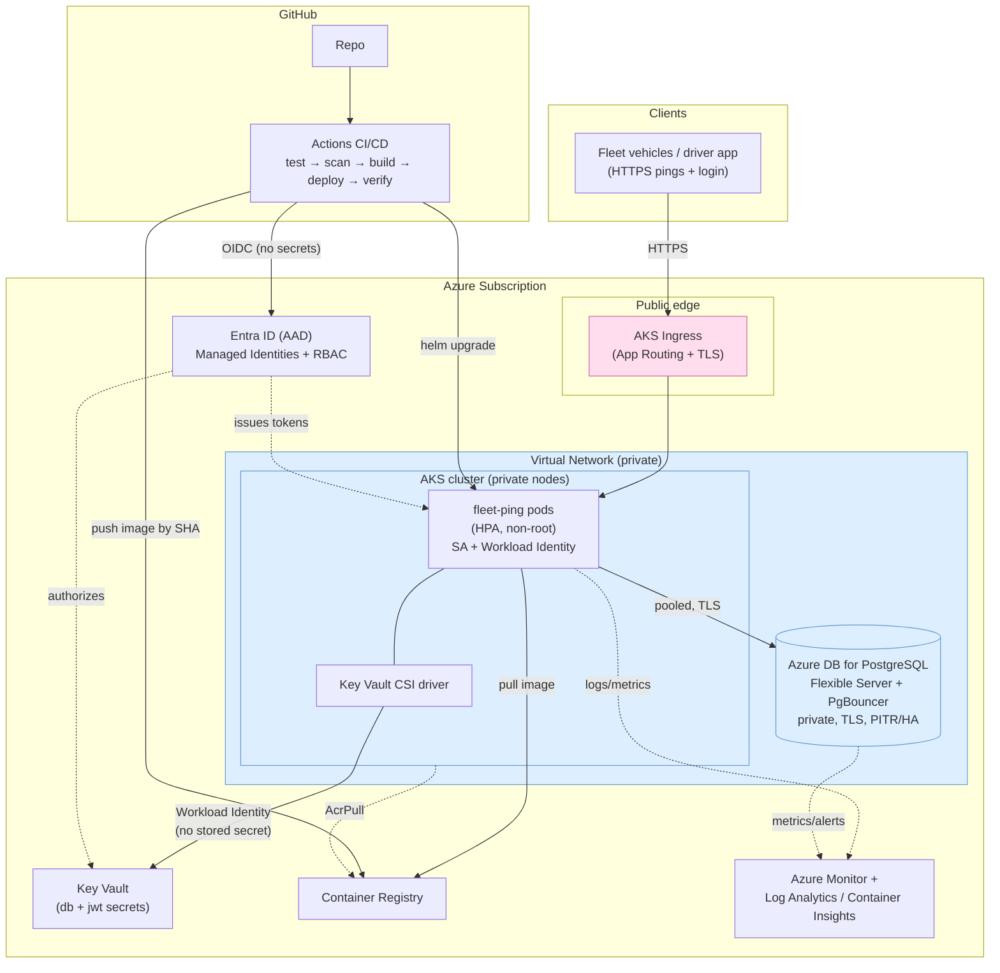

# Architecture

Proposed Azure architecture for the Fleet Ping Service. Technical clarity is
the goal; the diagram renders on GitHub (Mermaid).



## Network boundaries

- **Public:** only the AKS ingress (HTTPS/TLS). Everything else is private.
- **Private (VNet-only):** AKS nodes/API server (prod), PostgreSQL (VNet
  integrated, no public endpoint), Key Vault + ACR (private endpoints in prod).
- **No inbound to the database** from the internet; the app reaches it over the
  VNet through PgBouncer.

## Trust / identity

- Pods authenticate to Azure via **Workload Identity** (federated OIDC) — no
  client secrets in the cluster.
- CI authenticates via **GitHub OIDC** federation — no stored cloud creds.
- Secrets live in **Key Vault**, pulled at runtime via the **CSI driver**;
  never in git or images.
```
